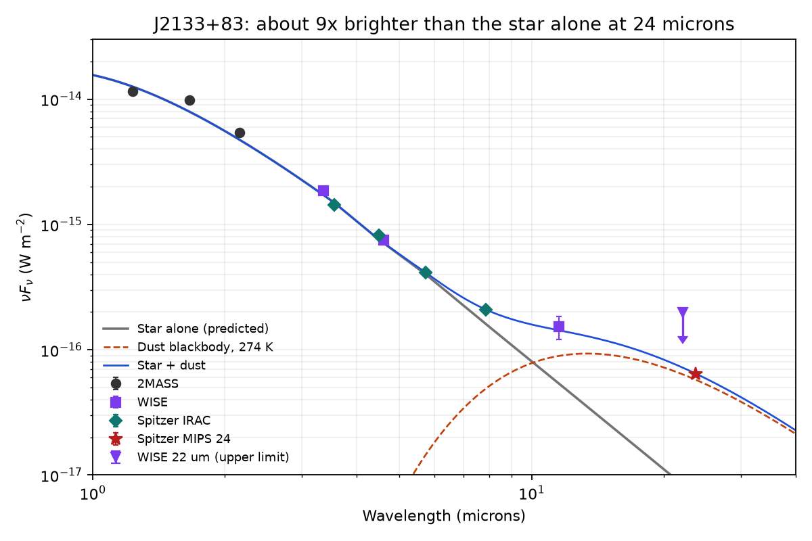

# debris-disks

Searching old Spitzer Space Telescope data for debris disks around K stars. This is our project for VOC ED 369CE (LACCD, Fall 2026) with Professor Sydney Skorpen, by Sonny Ramirez and Tyler Jeter.



## What we're looking for

A debris disk is a belt of dust and rubble left over from planet formation, kind of like our Kuiper Belt. The dust is warmed by the star and glows in the infrared, so a star with a disk looks brighter at 24 microns than the star alone should. We look for that extra light (the "infrared excess") using the Spitzer Enhanced Imaging Products (SEIP) catalog along with 2MASS.

## Main candidate: J2133+83

SSTSL2 J213307.73+830501.2 (Gaia DR3 2300237806311269248)

- About 9 to 10 times brighter at 24 microns than a normal K star should be, at around 18 sigma.
- The extra light fits dust at about 275 K giving off about 0.5% of the star's light.
- Its 24 micron light sits right on the star (about 1" off, which is normal scatter), so it isn't a galaxy sitting next to it.
- Isolation Forest flags it in 50 out of 50 runs, usually as the most unusual star in the sample.

This is a candidate, not a confirmed disk. The main open question is whether a background galaxy could be lined up right behind the star.

## How it works

1. **Clean the sample** (`sfr_cut.py`, `young_star_check.py`). Young stars and stars in star-forming regions can fake a disk, so we cut them using SIMBAD tags and their position on the sky.
2. **Measure the excess** (`excess_shape.py`). For each star we compare the 24 micron flux to what the star alone should give, and we look at the shape of the extra light across the IRAC bands.
3. **Machine learning** (`excess_shape.py`, `isoforest_v2.py`). Isolation Forest picks out the most unusual stars. K-means sorts the stars with an excess into a warm group (also bright at 8 microns, like J2133+83) and a cool/flat group (extra light mostly at 24 microns).
4. **Image check** (`vetting/`). We download the Spitzer images from IRSA and measure whether the 24 micron light is centered on the star. If it's off to the side, it's probably a background galaxy blending in. `batch_vet.py` runs this on all 116 stars with an excess plus a control group of normal stars. This is how we found that our second candidate, J0845-78, is likely a galaxy blend.

## Course steps

| Step | File |
| --- | --- |
| 1. Python environment | `hello_world.py`, `notebooks/step1.ipynb`, `environment.yml` |
| 2. Getting to know the data | `VOCED_step2.py` |
| 3. First plots | `VOCED_step3.py` |
| 4. Reducing the data | `VOCED_step4.py` |
| 5. First fit (line, parabola, blackbody) | `VOCED_step5.py` |
| 6. Handling a FITS file | `VOCED_step6.py` |

## Running it

```
conda env create -f environment.yml
conda activate disks
python excess_shape.py
```

The full SEIP table and the FITS images are too big for GitHub, so they aren't in the repo. The scripts read them from `data/`, and some of the file paths are written for Windows.

## Thanks

Professor Sydney Skorpen for her guidance and SED fits. This work uses data from the Spitzer Space Telescope (through NASA/IPAC IRSA), 2MASS, Gaia and SIMBAD.
